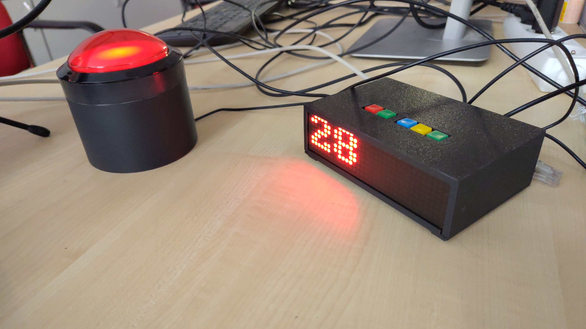

# LED panel

A small Raspberry Pi toy. It shows the time on an LED matrix, blinks an LED
and reacts to six buttons.

A [short video](https://youtu.be/8XoVibW1V2M) shows it running.

## Hardware

- MAX7219 LED matrix, 4 blocks, on SPI port 0
- LED on board pin 22 (GPIO25)
- Buttons on board pins 3, 5, 11, 13, 15 and 18, wired to 3V3

Pin numbers are BOARD numbers, not BCM.

## Run

    ./panel.py

Needs `luma.led_matrix` and `rpi-lgpio`, the maintained stand-in for
`RPi.GPIO`. Stop it with Ctrl-C.

To make the Pi start it on its own, see `setup/README.md`.

## Buttons

| Pin | What it does                |
|-----|-----------------------------|
| 3   | turns blinking on and off   |
| 5   | switches time, counter and talks, scrolls the name of the new one |
| 18  | adds one to the counter     |
| 11  | takes one from the counter  |
| 13  | scrolls the IPv4 addresses  |
| 15  | scrolls the next OpenAlt talk |

The counter is kept in `counter.txt` next to the script, so it survives a
restart. Every press goes to `buttons.csv`, one row with the time, the
seconds since boot and the pin. The seconds since boot are right even when the
clock is not set yet.

Pin 15 reads `openalt-2026_sessions.json` next to the script. It shows the
next talk in one of the rooms, for example `4d7h3m A113 Z ceho se sklada LLM
agent?`: the time until it starts, the room and the title. Each press shows
the next room. When no talk is left, it shows `OpenAlt 2026`. In the talks
mode of pin 5, the display shows the counter and scrolls one talk every minute,
each time from the next room too.

The file is not in the repository, it holds the speakers' contacts. Save the
output of the
[talks API](https://talks.openalt.cz/api/events/openalt-2026/submissions/?expand=speakers%2Cslots%2Cslots.room%2Ctrack&limit=1000&state=confirmed)
there, on the Pi that is `/opt/panel/openalt-2026_sessions.json`.

## Files

`panel.py` is the program. `examples/` holds the older demos it was built
from. They still run on their own. `hardware/` holds the wiring, the case and
the datasheets, see `hardware/README.md`.

## Licensing and attribution

The code in this repository is licensed under the [GNU General Public License,
version 3 or later](LICENSE). The SPDX identifier is `GPL-3.0-or-later`.

Original project documentation, photographs, drawings, and other non-code
artifacts are intended to be distributed under [Creative Commons
Attribution-ShareAlike 4.0 International (CC BY-SA 4.0)](https://creativecommons.org/licenses/by-sa/4.0/).
See [LICENSES.md](LICENSES.md) for the scope of that recommendation.

Third-party assets retain their original licensing and attribution. In
particular, the Raspberry Pi 3 model in `hardware/parts/raspberry-pi-3/` is
based on the Thingiverse model by alexandre_willame:
https://www.thingiverse.com/thing:1701186

The manufacturer datasheets in `hardware/datasheets/` are included for
reference and should be treated as vendor-provided material. See
[ATTRIBUTIONS.md](ATTRIBUTIONS.md) for the original source references and
important reuse notes.
